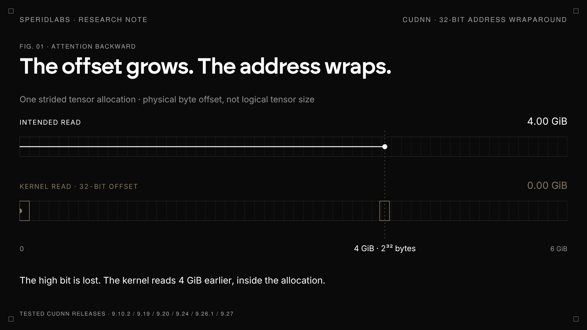
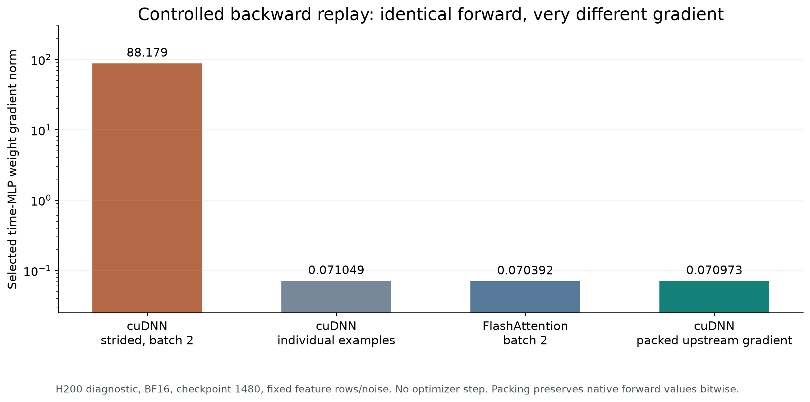

  

<h1 align="center">The cuDNN bug that breaks training at scale</h1>

https://github.com/user-attachments/assets/160d0cbe-2c69-4570-82fa-bf1b7dfbac64

A cuDNN attention backward kernel can lose the high bit of a BF16 byte offset
when a strided tensor view crosses 4 GiB. It then reads the wrong values from
within the same allocation and returns finite but incorrect gradients.

## Proof of concept and results

This repository contains runnable synthetic reproducers, controls, raw receipts,
and the measurements used in the report.

## Run the primary H200 reproducer

The test allocates about 4.0 GiB and requires at least 6 GiB of free GPU memory.
Use an H200 with the recorded software stack:

    python reproduction/run_reproducer.py \
      --output /tmp/cudnn-sdpa-repro \
      --expect-torch '2.14.1+cu126' \
      --expect-cuda '12.6' \
      --expect-cudnn '9.10.2' \
      --expect-gpu H200

The launcher checks the runtime, captures <code>collect_env</code>, runs the
same-batch comparison, and writes a result receipt. See the
[reproduction guide](docs/reproduction.md) for prerequisites, expected output,
exit codes, and safety requirements.

## Reproducer scripts

| PoC                                                                                                                                                         | What it checks                                                                                                               |
| ----------------------------------------------------------------------------------------------------------------------------------------------------------- | ---------------------------------------------------------------------------------------------------------------------------- |
| [run_reproducer.py](reproduction/run_reproducer.py)                                                                                                         | Validates the H200 environment and runs the primary test.                                                                    |
| [b2_fixed.py](reproduction/b2_fixed.py)                                                                                                                     | Compares identical inputs with packed and gapped incoming gradients.                                                         |
| [synthetic_boundary.py](reproduction/synthetic_boundary.py)                                                                                                 | Builds the boundary-crossing strided view and checks against a CPU FP64 reference.                                           |
| [c6_default_backend_probe.py](reproduction/c6_default_backend_probe.py)                                                                                     | Records the backend selected by default and compares explicit backends.                                                      |
| [poc_natural_trigger.py](reproduction/poc_natural_trigger.py)                                                                                               | Checks the gapped view produced by a concatenation backward path. This small structural case does not cross 4 GiB by itself. |
| [poc_width_variants.py](reproduction/poc_width_variants.py)                                                                                                 | Probes selected attention head widths.                                                                                       |
| [framework_te.py](reproduction/framework_te.py), [framework_jax.py](reproduction/framework_jax.py), [framework_paddle.py](reproduction/framework_paddle.py) | Bounded framework probes; see the documented limits before interpreting them.                                                |

## Measured results

### Same inputs, different memory layout

On the crossing batch, cuDNN's gapped result differs from the packed control by
relative L2 **0.1285 for dQ** and **0.1011 for dK**. dV matches. The batch below
the boundary matches across layouts. The separately measured errors against the
CPU FP64 reference are **0.1305 for dQ** and **0.1022 for dK**; these are a
different comparison.

- [Same-batch result receipt](evidence/receipts/layout/same-batch-detector/result.json)
- [Crossing-boundary receipt](evidence/receipts/core/crossing-boundary/result.json)
- [Below-boundary control](evidence/receipts/core/below-boundary/result.json)
- [Fresh H200 result and environment](evidence/fresh-h200-20261026/)

### Native address-arithmetic intervention

In the captured SM90 prepass, widening the identified byte arithmetic reduced
the discrepancy in D from **0.5726 to 4.35 × 10⁻⁸** and matched the packed
vendor control bitwise across **6,365,184 rows**. This establishes agreement
with that control, not exact FP64 correctness.

- [Native intervention measurements](evidence/native/native-prepass-summary.json)

### Tested cuDNN versions and controls

The crossing case reproduced at the discrete cuDNN versions listed below. This
does not establish that every intervening release is affected or identify a
fixed release.

| cuDNN runtime | Result     |
| ------------- | ---------- |
| 9.10.2        | Reproduced |
| 9.19.0.56     | Reproduced |
| 9.20.0.48     | Reproduced |
| 9.24.0.43     | Reproduced |
| 9.26.1.1      | Reproduced |
| 9.27.0.42     | Reproduced |

- [All version receipts](evidence/receipts/versions/)
- [Full tested-version and architecture matrix](docs/version-matrix.md)
- [Raw result tables](data/README.md)
- [Sanitizer receipts](evidence/receipts/sanitizers/)

## What fails

The measured SM90 backward prepass computes <code>D = sum(O × dO)</code>. It
scales the BF16 element offset in a 32-bit register before adding the pointer's
high word:

    0x0e80  IMAD.SHL.U32  R17, R12, 0x2, RZ
    0x0ee0  IADD3         R16, P1, R17, R8, RZ
    0x0ef0  IMAD.X        R17, RZ, RZ, R9, P1
    0x0f10  LDG.E.128.CONSTANT R12, desc[UR8][R16.64]

The first instruction drops the high bit at the 4 GiB byte boundary. The later
64-bit pointer addition cannot recover it. CUPTI launch arguments and the
loaded cubin identified the path
<code>cudnn::fusion::compute_dot_do_o_specialized&lt;true,128&gt;</code> in
<code>libcudnn_engines_runtime_compiled.so.9</code>.

  

The synthetic view has logical shape <code>(2, 256, 1, 128)</code> and occupies
131,072 logical bytes. Its reachable byte span is 4,295,000,064 bytes.

  

## Mitigation

The [PyTorch patch](patches/pytorch/0001-guard-cudnn-sdpa-backward-byte-spans.patch)
is a framework-side mitigation: it checks the reachable byte spans of saved
output O and incoming gradient dO, and packs supported layouts before the
cuDNN backward call. The permanent arithmetic correction belongs in cuDNN.
The patch remains a candidate; see the [mitigation note](docs/pytorch-mitigation.md).

The H200 results are dynamic observations. Architecture-level inspection beyond
H200 is documented separately and does not imply runtime reproduction on those
GPUs. This report does not establish cross-process access, code execution, or a
reachable out-of-bounds write. No CVE or fixed cuDNN release has been confirmed.

## Research notes and evidence

| Document                                               | Contents                                                     |
| ------------------------------------------------------ | ------------------------------------------------------------ |
| [Reproduction guide](docs/reproduction.md)             | Environment, command, expected results, and safety limits.   |
| [Evidence ledger](docs/evidence-ledger.md)             | Claim-by-claim measurements, controls, and limits.           |
| [Version matrix](docs/version-matrix.md)               | Tested software versions and architecture evidence.          |
| [Security scope](docs/security-scope.md)               | What the experiments establish and what remains unconfirmed. |
| [PyTorch mitigation](docs/pytorch-mitigation.md)       | Candidate guard behavior and validation limits.              |
| [Disclosure status](docs/disclosure.md)                | Current vendor and maintainer coordination.                  |
| [Data guide](data/README.md)                           | CSV sources, columns, and rebuild command.                   |
| [Experiment index](experiments/README.md)              | PoC families and receipt locations.                          |
| [Figure index](figures/README.md)                      | Figures and their source data.                               |
| [Source map](docs/source-map.md)                       | Repository structure and provenance.                         |
| [Script provenance](reproduction/SOURCE-PROVENANCE.md) | Reproducer source revisions and checksums.                   |
| [Publication contents](release/PUBLIC-EXPORT.md)       | Included evidence and publication scope.                     |
| [Current status](STATUS.md)                            | Repository, reproduction, and disclosure state.              |
| [License status](LICENSE-STATUS.md)                    | Project and third-party asset licensing.                     |
